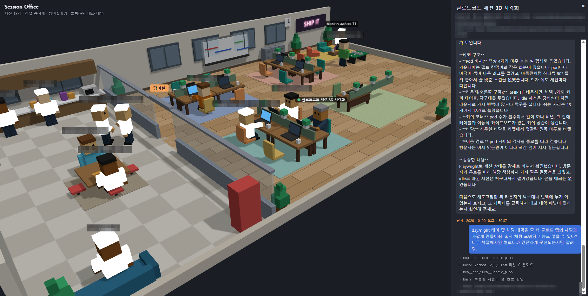
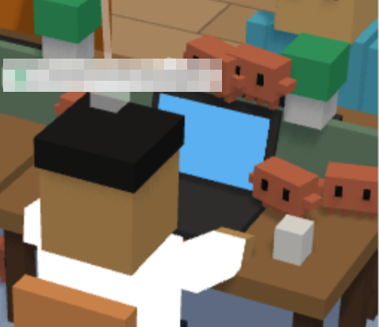
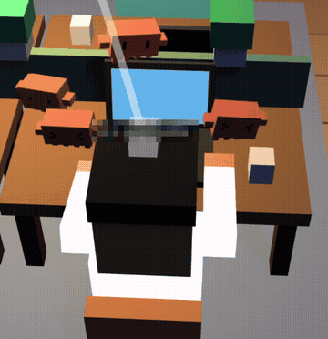
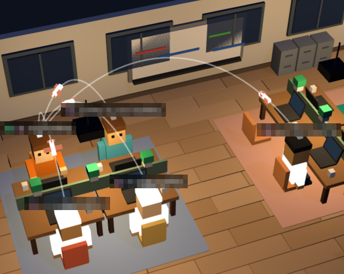
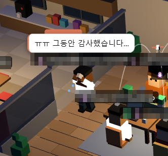

# Session Office

내 PC에서 돌아가는 **Claude Code와 Codex 세션들을 3D 복셀 사무실로 보여 주는 대시보드**입니다.
세션 하나가 직원 한 명이 되어, 일할 때는 자리에 앉아 타이핑하고, 쉴 때는 탕비실·라운지로 가고, 종료되면 짐을 싸서 퇴근합니다.
캐릭터를 클릭하면 그 세션의 대화 내역을 오른쪽 패널에서 바로 볼 수 있습니다.

외부 의존성이 없습니다. Node.js(v18 이상)만 있으면 됩니다.



## 주요 기능

### 세션 = 직원
- **작업 중** 세션은 자기 책상에 앉아 타이핑합니다. 셸 명령이나 백그라운드 작업이 돌고 있으면 노트북 화면에 터미널 출력이 스크롤됩니다.
- **답변 대기** 중인 세션(권한 확인, 질문 등) 머리 위에는 `?`가 빙글빙글 돕니다.
- 휴식 중이어도 **셸 명령이나 모니터가 돌고 있으면** 놀러 가지 않고 자리에서 대기합니다.
- **휴식 중**(idle) 세션은 탕비실로 가서 커피·간식을 먹거나, 라운지에서 빈백에 앉거나 탁구를 칩니다.
- 사용자(파란 옷의 방문자)는 평소 화이트보드에 무언가를 쓰다가, 세션에 질문이 생기면 해당 책상까지 걸어가 말풍선으로 질문합니다.
- 이름표의 아이콘은 세션이 돌아가는 곳을 나타냅니다. 🐧 Linux/WSL, 🪟 Windows, 🍎 macOS.
- 환경 바로 옆에는 Claude 로고 또는 ChatGPT 로고(Codex)가 붙습니다. 이름표·직원 목록·대화 패널·히스토리에 동일하게 표시하며, 로고에 마우스를 올리면 에이전트 이름을 볼 수 있습니다. 두 종류 모두 같은 로컬 사무실에 앉습니다.

### Codex 세션
- 로컬 Codex CLI와 Desktop의 `~/.codex/sessions/` 기록을 읽습니다. `CODEX_HOME`이 설정되어 있으면 그 경로를 사용합니다. Codex가 없는 PC에서는 기존 Claude 기능만 그대로 동작합니다.
- macOS/Linux/WSL에서는 `lsof`로 Codex가 현재 열어 둔 세션 기록·writer lock을 찾아 표시합니다. Desktop에서 불러온 채팅은 턴이 끝나도 휴식 중으로 남을 수 있습니다.
- 대화와 도구 호출, 작업 시작·완료·중단, 입력 질문 대기, 연결된 서브에이전트를 표시합니다. 시스템 지침과 내부 추론은 대화 패널에 표시하지 않습니다. 권한 승인 대기는 기록에 남지 않을 수 있어 정확히 구분하지 못합니다.
- `lsof`가 없거나 실행할 수 없는 환경(Windows 포함)에서는 최근 15분 내 기록이 바뀐 세션을 **상태 미확인**으로 표시합니다. WSL에서 Windows 쪽 Codex 기록은 자동 수집하지 않습니다.
- Codex는 여러 채팅이 같은 프로세스를 공유할 수 있어 **해고 버튼을 비활성화**합니다. 종료는 Codex 앱 또는 CLI에서 해 주세요. 지난 세션은 히스토리에서 `codex resume <세션 ID>` 복구 명령을 복사할 수 있습니다([공식 CLI 문서](https://developers.openai.com/codex/cli/reference#codex-resume)).
- 큰 과거 기록은 마지막 256 KiB만 읽어 히스토리 로딩을 제한합니다. 이때 표시되는 `최근 기록 N턴`은 전체 턴 수가 아닙니다. 실행 세션은 최초 읽기 뒤 추가된 기록만 읽습니다.
- Codex 연동은 로컬 파일만 읽으며 로그인 정보·세션 파일·Codex 설정을 변경하지 않습니다. 원격 Codex·클라우드 세션은 이 연동의 대상이 아닙니다.

### 대화 내역 패널
캐릭터나 직원 목록을 클릭하면 카메라가 그 직원에게 다가가고, 오른쪽 패널에 상태·턴 수·작업 경로·최근 도구와 함께 대화 내역이 열립니다(위 스크린샷 오른쪽).
답변은 마크다운으로 렌더링되고, 도구 호출은 접을 수 있는 묶음으로 정리됩니다. 패널 왼쪽 가장자리를 드래그하면 너비를 조절할 수 있습니다.

### 서브에이전트 = 작은 컴패니언
세션이 서브에이전트를 돌리는 동안, Claude 작업에는 주황색 복셀 Clawd가, Codex 작업에는 기본 Codex 컴패니언을 본뜬 파란색 복셀 캐릭터가 노트북 주변에 올라앉아 일합니다. Codex 캐릭터는 짙은 화면 얼굴에 `>_` 표정이 나타납니다. 두 캐릭터 모두 같은 자리 배치와 들썩임·팔 움직임·눈 깜박임을 사용하며 최대 12마리까지 표시합니다.

| 정지 화면 | 동작 ([원본 영상](docs/media/subagents.mp4)) |
|---|---|
|  |  |

### 원격 PC · 클라우드 세션 (원격 사무실)
Remote Control이 켜진 **다른 PC의 세션**과 **claude.ai/code 클라우드 세션**도 함께 보입니다. 자세한 내용은 아래 [원격 세션](#원격-세션) 항목을 참고하세요.
- 원격 PC마다 별관 사무실이 생깁니다. 각 별관은 전선으로 복셀을 쌓아 만든 커다란 둥근 위성 안테나와 연결되어 있고, 안테나는 좌우로 고개를 까딱거립니다.
- 클라우드 세션은 하늘에서 직원마다 구름 하나씩을 타고 일합니다. 책상과 의자도 구름이고, 노트북만 평소 것을 씁니다. 구름은 천천히 위아래로 떠다니고, 밤에는 직원 오른쪽의 무드등과 모니터의 은은한 푸른 광원이 켜져 얼굴과 상체를 비춥니다. 두 광원은 낮에 꺼집니다.
- 사무실들은 서로 멀리 떨어져 있어서, 최대로 줌아웃해도 지금 보고 있는 사무실만 보입니다. 다른 사무실로는 사무실 탭에서 이동합니다.
- 원격 세션을 해고하면 아카이브되고, 직원은 자리에서 스르륵 사라집니다.
- `☰ 직원 목록`의 **사무실** 탭에서 로컬 / 원격 PC / 클라우드 사무실 목록을 보고, 클릭하면 그 사무실로 이동하고, **직원** 탭에는 선택한 사무실의 직원만 표시됩니다. `⤢ 전체 보기`는 지금 보고 있는 사무실 전체를 화면에 맞춥니다.

### OpenRig 팀 시각화 (선택)
[OpenRig](https://github.com/mvschwarz/openrig)로 여러 에이전트를 한 팀(rig)으로 돌리고 있다면, 같은 팀 세션들이 한 pod에 모여 앉고 누가 누구에게 일을 넘기는지가 책상 사이의 비행 경로로 그려집니다. 자세한 내용은 아래 [OpenRig 연동](#openrig-연동) 항목을 참고하세요.



### 해고(세션 종료)와 복구
`☰ 직원 목록`에서 **해고**를 누르면 확인 후 해당 Claude Code 프로세스를 종료합니다(터미널에서 Ctrl+C를 누른 것과 같습니다).
해고된 직원은 "ㅠㅠ 그동안 감사했습니다…"라고 울면서 사무실을 나갑니다. 그냥 끝난 세션은 울지 않고 퇴근합니다.



종료된 세션은 **히스토리 (복구)** 탭에 남습니다. `복사` 버튼으로 `cd <작업 경로> && claude --resume <세션 ID>` 명령을 복사해 터미널에 붙여 넣으면 이어서 작업할 수 있습니다.

### 기타
- **낮/밤 테마**: 7시~19시는 낮, 그 외는 밤 테마로 자동 설정되며 상단 버튼으로 바꿀 수 있습니다. 밤에는 펜던트 조명이 켜집니다.
- **⤢ 전체 보기**: 현재 시점을 유지한 채 지금 보고 있는 사무실 전체가 화면에 들어오도록 맞춥니다.
- 카메라 쪽 벽은 심즈처럼 무릎 높이로 낮아져 안이 잘 보입니다. 마우스로 회전·확대할 수 있습니다.

### 할로윈 이벤트
- 매년 **10월 20일 00:00부터 11월 1일 23:59:59까지**, 브라우저의 현지 날짜를 기준으로 본사 사무실을 꾸밉니다. 화면을 켜 둔 채 날짜가 바뀌어도 자동으로 시작·종료됩니다.
- 탕비실과 라운지 주변에는 둥둥 떠다니는 촛불, 벽에는 따뜻한 앵두조명이 달린 박쥐 가렌드가 나타납니다. 가렌드는 창문 사이의 뾰족한 꼭짓점에서 늘어지며, 카메라 앞의 벽이 내려갈 때 함께 숨겨집니다.
- 웃는 잭오랜턴은 입구와 선반을 장식하며, 밤 테마에서는 주황색 광원으로 주변을 비춥니다.
- 사무실 바깥의 귀여운 유령 두 마리는 서로 다른 방향·속도로 사무실 주변을 배회하며 위아래로 둥실거립니다. 서서히 나타났다 사라지는 동안에도 이동 경로는 이어집니다. 운영체제의 동작 줄이기 설정을 사용하면 촛불과 유령은 정지 상태로 표시됩니다.
- 사용자와 Claude·Codex 서브에이전트는 마녀모자를 쓰고, 작업 에이전트는 초록빛 피부와 머리 양옆 볼트가 있는 좀비로 변신합니다. 새로 등장하는 캐릭터에도 적용되며 이벤트가 끝나면 원래 모습으로 돌아옵니다. 캐릭터 분장은 원격·구름 사무실에도 적용됩니다.
- 소품 참고: [떠다니는 촛불과 박쥐 장식](https://www.michaels.com/product/80-pcs-halloween-hanging-witch-hats-and-floating-candles-set-12-black-witch-hats-with-12-led-taper-candles-and-remote-56-3d-bat-wall-stickers-with-hanging-ropes-spooky-halloween-decorations-for-porch-yard-garden-door-tree-and-party-501470213559205890), [호박·박쥐·유령 가렌드](https://www.michaels.com/product/6-ft-halloween-willow-vine-garland-with-led-pumpkin-bat-ghost-lights-orange-purple-white-498088382097162240). 이미지를 다운로드하지 않고 기존 복셀 스타일로 구현합니다.

#### 다른 계절 이벤트 추가하기

`client/js/core/seasonal-events.js`의 `SeasonalEvent` 인터페이스를 따르는 정의를 `client/js/world/room.js`의 `createSeasonalEvents([...])` 목록에 추가합니다. `period`는 시작일과 종료일을 모두 포함하며, 12월→1월처럼 연도를 넘는 기간도 지원합니다. 크리스마스 소품 자체는 아직 등록되어 있지 않습니다.

```js
const christmasEvent = {
  id: 'christmas',
  period: { start: { month: 12, day: 20 }, end: { month: 1, day: 6 } }, // 예시 기간
  create({ parent, walls, bounds, camera }) {
    // parent: 방 Group, walls: 방향별 벽 Group, bounds: 현재 배치, camera: 카메라
    // 장식 생성 후 아래 생명주기를 반환합니다.
    return {
      update(now) { /* 프레임 시간(ms)으로 애니메이션 갱신 */ },
      dispose() { /* 장식 제거, 전용 재질 해제, 테마 광원 등록 해제 */ },
    };
  },
};
```

방이 확장되면 기존 이벤트를 정리한 뒤 새 배치로 다시 생성합니다. `vox()`의 공유 geometry/material은 해제하지 않습니다. 이벤트 종료·시작과 연말 날짜 경계는 `npm test`로 검증합니다.

## 실행 방법

### 요구 사항
- Node.js **v18 이상**
- Claude Code 또는 Codex를 쓰고 있는 PC (`~/.claude` / `~/.codex` 폴더를 읽습니다)
- Codex 실행 세션 확인에는 `lsof`가 필요합니다. 없으면 위의 최근 활동 기준으로 표시합니다.

### macOS / Linux / WSL
```bash
git clone https://github.com/Achelous1/sessions-office.git
cd sessions-office
./start.sh
```
서버를 띄우고 브라우저를 자동으로 엽니다. 이미 실행 중이면 브라우저만 엽니다. 종료는 `Ctrl+C`입니다.

### Windows
`start.cmd`를 더블클릭합니다.
- WSL에 node가 설치돼 있으면 WSL에서 실행합니다. 이 경우 **WSL 세션과 Windows 세션을 모두** 볼 수 있습니다.
- WSL을 쓰지 않으려면 실행 전에 `set NO_WSL=1`을 지정합니다.

### 직접 실행
```bash
node server         # 또는 npm start
```
그다음 브라우저에서 http://localhost:4545 를 엽니다.

### 환경 변수
| 이름 | 기본값 | 설명 |
|---|---|---|
| `PORT` | `4545` | 서버 포트 (`PORT=5000 ./start.sh`) |
| `SHOW_SDK` | (꺼짐) | `1`이면 SDK로 띄운 세션(claude-mem observer 등)도 표시 |
| `NO_WSL` | (꺼짐) | Windows `start.cmd`에서 WSL 대신 Windows node로 실행 |
| `REMOTE` | (켜짐) | `0`이면 원격 연결을 꺼진 상태로 시작 (📡 버튼으로 한 번이라도 바꾼 뒤에는 저장된 설정을 따름) |
| `MAX_CLOUD_SESSIONS` | `24` | 구름 사무실에 보여 줄 클라우드 세션 수 (최근 생성 순) |
| `CODEX_HOME` | `~/.codex` | 읽을 로컬 Codex 상태 폴더 |

## 원격 세션

Remote Control이 켜진 다른 PC의 세션과 claude.ai/code 클라우드 세션을 보여 줍니다. 따로 설정할 것은 없습니다. 이 PC에서 Claude Code에 로그인되어 있으면 자동으로 불러옵니다.

왼쪽 아래 **📡 원격 연결** 버튼으로 켜고 끌 수 있습니다. 끄면 `api.anthropic.com`에 요청을 전혀 보내지 않고 원격 직원도 사라집니다. 이 설정은 `~/.session-office/settings.json`에 저장되어 다시 실행해도 유지됩니다.

> ⚠️ **비공식 API를 씁니다.** 세션 목록은 claude.ai 웹과 Remote Control이 쓰는 `api.anthropic.com/v1/code/sessions`에서 가져옵니다. 이 API는 공개 문서가 없어서, Anthropic이 바꾸면 예고 없이 동작하지 않을 수 있습니다. 그래도 로컬 사무실은 영향을 받지 않습니다. 원치 않으면 📡 원격 연결 버튼으로 끄세요.

### 어떤 세션이 어디에 앉나
| 세션 | 표시 조건 | 사무실 |
|---|---|---|
| 다른 PC의 Remote Control 세션 | 아카이브되지 않았고 PC와 연결된 상태 | PC마다 별관 1개 (📡) |
| 클라우드 세션 (claude.ai/code) | 아카이브되지 않은 세션 중 최근 `MAX_CLOUD_SESSIONS`개 | 구름 사무실 1개 (☁️) |
| 이 PC의 세션 | — | 본사 (원격 목록에서는 빠짐) |

- 원격 직원은 항상 자기 자리에 앉아 있습니다. 상태는 작업 중 / 답변 대기(`?`) / 휴식으로 표시되고, 매 턴 끝의 한 줄 요약이 말풍선으로 뜹니다.
- **작업 중인** 원격 세션은 15초마다 최근 대화 기록을 확인해, 셸·모니터가 돌면 노트북에 터미널 출력이 흐르고 실행 중인 서브에이전트 수만큼 Clawd가 나타납니다. 요청 수를 줄이려고 답변 대기·휴식 중인 세션은 확인하지 않으며, 한 번에 4개씩만 요청합니다.
- 클릭하면 대화 내역 패널에 최근 대화가 열립니다.
- **해고**하면 세션을 아카이브합니다. 원격 세션은 히스토리 탭에서 다시 열 수 없습니다.

### 알려진 제한: 원격 PC 구분
API의 세션 정보에는 "어느 PC인지"를 알려 주는 필드가 없습니다. 그래서 Remote Control이 자동으로 붙이는 제목(`<호스트명>-<단어>-<단어>`, 예: `mac-mini-local-happy-otter`)에서 호스트명을 읽습니다.
- 첫 메시지 뒤에 제목이 바뀌어도 알아볼 수 있도록, 처음 본 호스트명을 `~/.session-office/remote-hosts.json`에 기억해 둡니다.
- Session Office가 꺼져 있는 동안 시작해서 이미 제목이 바뀐 세션은 PC를 알 수 없어 **원격 PC (미확인)** 사무실로 갑니다.
- 이 PC의 호스트명과 같은 세션은 본사에 이미 있으므로 원격 목록에서 뺍니다.

### 로그인 정보
- `~/.claude/.credentials.json`에서 Claude Code의 로그인 토큰을 읽습니다. macOS는 키체인(`Claude Code-credentials`)에서 읽습니다.
  - macOS에서는 처음 실행할 때 "security이(가) 키체인의 기밀 정보를 사용하려고 합니다" 같은 창이 뜹니다. **항상 허용**을 누르면 다음부터는 묻지 않습니다. 창에 응답하지 않거나 거부하면, 사무실 탭에 그 이유가 표시되고 1분 뒤 다시 시도합니다.
- 조직 정보는 `~/.claude.json`에서 읽습니다.
- 토큰은 `api.anthropic.com`에만 보냅니다. 만료된 토큰은 Claude Code를 한 번 실행하면 갱신됩니다.
- 목록은 5초마다 백그라운드에서 갱신합니다. API가 느리거나 연결되지 않아도 로컬 사무실은 기다리지 않습니다.

## OpenRig 연동

[OpenRig](https://github.com/mvschwarz/openrig)는 Claude Code와 Codex 세션 여러 개를 하나의 팀(**rig**)으로 묶어 실행하는 오픈소스 멀티 에이전트 하네스입니다. 팀 구성을 YAML로 적어 두면 한 번에 띄울 수 있고, 로컬 데몬이 각 세션과 세션 사이의 관계(토폴로지)를 관리합니다.
Session Office는 이 데몬을 읽기만 합니다. OpenRig를 쓰지 않아도 다른 기능은 모두 그대로 동작합니다.

### 켜는 방법
따로 설정할 것은 없습니다. OpenRig 데몬이 실행 중이면 자동으로 연결됩니다.
1. OpenRig로 rig를 띄웁니다(설치와 사용법은 [OpenRig 저장소](https://github.com/mvschwarz/openrig)를 참고하세요).
2. Session Office를 실행합니다. 이미 실행 중이면 10초 안에 반영됩니다.

### 화면에 보이는 것
| 표시 | 의미 |
|---|---|
| 같은 pod에 모여 앉은 직원들 | 같은 rig에 속한 세션. rig 멤버가 먼저, rig 안의 순서대로 자리를 잡습니다 |
| 책상 사이의 흰 곡선 + 날아가는 복셀 비행기 | rig 그래프의 연결(edge). 비행기는 보내는 쪽에서 받는 쪽으로 날아갑니다. 멀리 떨어진 책상일수록 곡선이 높게 뜹니다 |
| 대화 패널 상단의 `rig <이름>/<logicalId>` | 이 세션이 속한 rig와 그 안에서의 역할 ID |
| 휴식 중이어도 자리에 앉아 있음 | rig 멤버는 대기 중에도 탕비실로 가지 않고 자리를 지킵니다 |

### 동작 원리
- 서버가 `~/.openrig/daemon.json`에서 데몬 포트를 읽고, `http://127.0.0.1:<port>/api/rigs`와 `/api/rigs/<id>/graph`를 조회합니다. 결과는 10초 동안 캐시하고, 요청마다 2초 타임아웃이 걸려 있습니다.
- 그래프 노드의 `resumeToken`(Claude Code 또는 Codex의 원본 세션 ID)으로 화면의 직원과 짝을 맞춥니다. 토큰이 오래돼 맞지 않으면 세션 이름(`canonicalSessionName`)으로 찾습니다.
- 데몬이 없거나 응답이 없으면 `/api/rigs`는 빈 목록을 돌려주고, 연동 표시만 사라집니다.
- 데몬 접속은 로컬(127.0.0.1)에서만 하며, OpenRig 쪽 상태는 바꾸지 않습니다.

## 동작 방식과 보안

- 서버는 `~/.claude/sessions/*.json`에서 살아 있는 세션을 찾고, `~/.claude/projects/` 아래의 트랜스크립트(`.jsonl`)를 읽어 대화 내역과 상태를 만듭니다. WSL에서는 `/mnt/c/Users/*/.claude`도 함께 읽습니다.
- 세션 파일의 PID와 프로세스 시작 시각을 대조해, PID가 재사용된 오래된 세션은 걸러 냅니다.
- 서버는 **127.0.0.1에만 바인딩**되므로 다른 PC에서는 접속할 수 없습니다. 해고 API는 커스텀 헤더를 요구해, 다른 웹사이트가 브라우저를 통해 세션을 종료할 수 없게 막습니다.
- 외부로는 원격 세션을 불러올 때 `api.anthropic.com`에만 접속합니다(`REMOTE=0`이면 이것도 하지 않음). 그 밖에는 로컬 파일과 (있다면) 로컬 OpenRig 데몬만 읽습니다. three.js와 marked는 `client/vendor/`에 포함되어 있어 CDN 접속도 필요 없습니다.

## 구성

서버와 클라이언트로 나뉘어 있습니다. 서버는 로컬 파일을 읽어 JSON API를 제공하고, 클라이언트는 그 API만 보고 화면을 그립니다.

```
server/                Node.js HTTP 서버 (의존성 없음)
  index.js             진입점: 서버 생성·실행
  config.js            포트, 읽을 ~/.claude 위치(WSL이면 Windows 쪽 포함)
  processes.js         세션 프로세스 생존 확인(PID 재사용 검사)과 종료
  transcripts.js       트랜스크립트(.jsonl) → 대화 내역·셸 활동 파싱 (변경 시에만 다시 읽음)
  sessions.js          살아 있는 세션 목록·요약, 서브에이전트, 히스토리와 복구 명령
  codex.js             로컬 Codex 기록·실행 세션·대화·상태·히스토리 (읽기 전용)
  rigs.js              OpenRig 데몬 조회 (선택)
  anthropic-api.js     claude.ai 세션 API 호출 (로그인 토큰 사용)
  remote.js            원격 PC·클라우드 세션 → 세션 요약, PC별 사무실 구분, 아카이브
  static.js            client/ 정적 파일 제공 (폴더 밖 접근 차단)
  routes.js            API 라우팅
client/                브라우저 (빌드 없이 ES 모듈 그대로 사용)
  index.html, styles.css
  js/main.js           진입점: 초기화와 렌더 루프
  js/api.js            서버 API 호출
  js/sync.js           2초마다 폴링해 사무실 상태를 맞춤
  js/core/             three.js 엔진, 복셀 헬퍼, 낮/밤 테마, 화면 오버레이(이름표·말풍선)
  js/world/            배치(layout), 사무실(room), 원격·구름 사무실(offices), 위성 안테나, 구름 책상, 길찾기, 책상·직원,
                       방문자, OpenRig 연결선, 노트북 화면
  js/characters/       사람, Clawd(서브에이전트), 물음표, 우는 효과
  js/ui/               대화 패널, 사무실·직원 목록·히스토리, 카메라 이동, 클릭 선택, 마크다운
  vendor/              three.js, OrbitControls, marked v12.0.2
  assets/logos/        Claude·ChatGPT 로고와 출처 (외부 요청 없이 표시)
test/                  서버 단위 테스트 (npm test)
start.sh, start.cmd    실행 스크립트
docs/media/            README용 스크린샷·영상
```

### API
| 메서드 | 경로 | 설명 |
|---|---|---|
| GET | `/api/sessions` | 살아 있는 세션 요약 목록 (로컬 + 원격 PC + 클라우드, 각각 `workspace` 포함) |
| GET | `/api/session/:id` | 세션 하나와 최근 대화 300개 |
| POST | `/api/session/:id/fire` | 로컬 세션 종료 / 원격 세션 아카이브 (`x-office: 1` 헤더 필요) |
| GET | `/api/history` | 지난 세션과 복구 명령 |
| GET | `/api/rigs` | OpenRig 팀과 위임 관계 |
| GET | `/api/remote` | 원격 연결 여부, 마지막 오류, 원격 세션별로 API가 보낸 상태값과 그걸 어떻게 읽었는지 (상태 판정 확인용) |
| POST | `/api/remote` | `{ "enabled": true/false }`로 원격 연결 켜기·끄기 (`x-office: 1` 헤더 필요) |

### 테스트
```bash
npm test
```

## 라이선스

[The Unlicense](LICENSE) — 퍼블릭 도메인. 상업적 이용을 포함해 누구나 조건 없이 자유롭게 사용·수정·배포할 수 있습니다. 단, `client/vendor/`의 서드파티 파일은 각 파일에 명시된 MIT 라이선스를 따릅니다.
